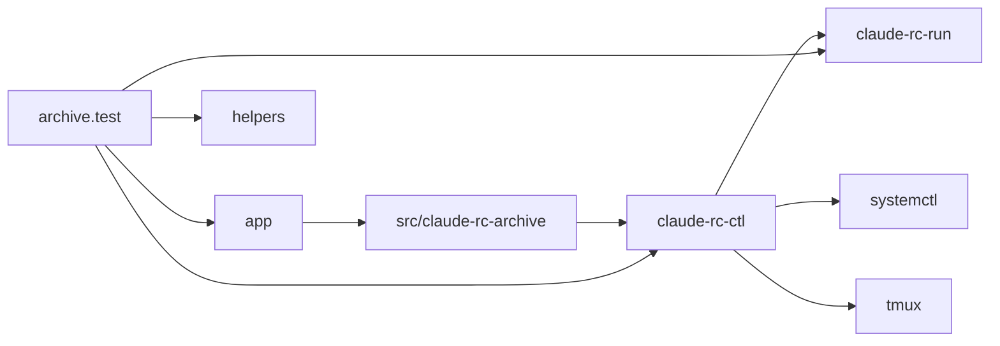
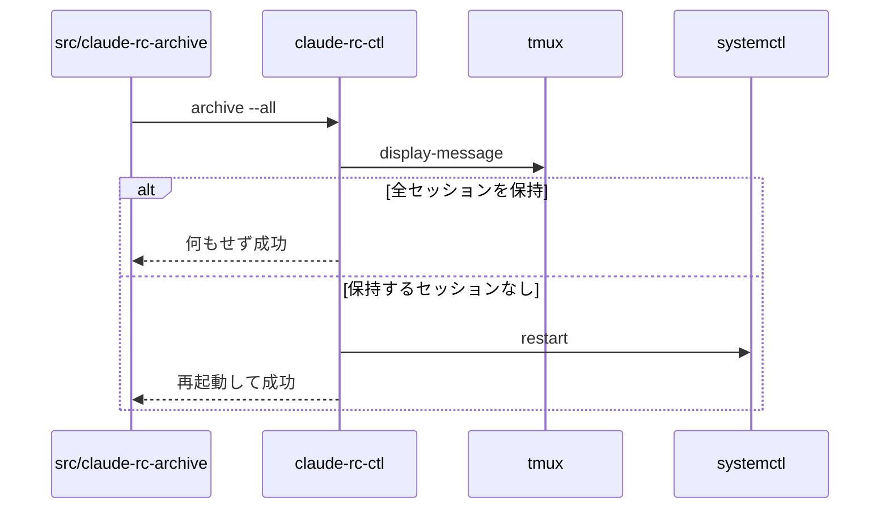

# claude-rc-archive 設計書

## 1. 構成

| パス                            | 責務                                                                                                                 |
| ------------------------------- | -------------------------------------------------------------------------------------------------------------------- |
| `src/claude-rc-ctl`             | archive サブコマンド。対象の選択、判定、サーバーの再起動を行う。本体の更新の検出と、セッションの起動失敗の警告も行う |
| `src/claude-rc-run`             | セッションを事前に作らない指定で remote-control を起動する                                                           |
| `src/claude-rc-archive.service` | 一括判定を1回実行する oneshot のユーザー単位ユニット                                                                 |
| `src/claude-rc-archive.timer`   | 一括判定を10分ごとに起動するタイマー                                                                                 |
| `installer/app.sh`              | 定期実行ユニットの配置・有効化・無効化・撤去と、旧ユニットの撤去                                                     |
| `tests/helpers.mjs`             | tmux の display-message・capture-pane と systemctl の停止状態を返す擬似コマンド                                      |
| `tests/archive.test.mjs`        | archive と定期実行ユニット、起動指定のテスト                                                                         |

## 2. 関係図・ワークフロー

呼び出しと配置の依存方向を示す（テストを含む）。



一括判定の流れと、保持か再起動かの分岐を示す。



## 3. 設計項目

### D-1: アーカイブの仕組み (FR-1, FR-8)

remote-control は、停止シグナル（SIGTERM・SIGHUP）を受けると、配下の子セッションを止めたうえで、再開用の記録（ポインタ）がなければ、動作中のセッションをアーカイブして環境を登録解除する。ポインタは起動時にセッションを事前に作ったときだけ書かれ、あると再開用に保持されてアーカイブされない。そのため、起動ラッパーは事前作成を無効にして起動する。

```bash
exec claude remote-control \
  --no-create-session-in-dir \
  --spawn "${CLAUDE_RC_SPAWN:-same-dir}" \
  --permission-mode "${CLAUDE_RC_PERMISSION_MODE:-auto}" \
  --remote-control-session-name-prefix "$(hostname)-<name>"
```

サーバーの再起動は `systemctl --user restart claude-rc@<name>.service` とする。停止時に tmux のサーバーを閉じ、残ったプロセスへ systemd が SIGTERM を送り、既定の待ち時間内に終了を待つ。再起動後は新しい環境が登録され、セッションは利用者がアプリから作る。

### D-2: 判定 (FR-1, FR-2, FR-3, FR-7)

```
claude-rc-ctl archive [--dry-run] <name>
  need_name <name>                              # 未登録は「未登録です」で終了コード1
  idle = ${CLAUDE_RC_ARCHIVE_MINUTES:-10080}      # 整数以外はエラー、0 なら何もせず成功
  systemctl --user is-active が active でない → 何もせず成功
  server = tmux -L claude-rc-<name> display-message -p -t <name> '#{pane_pid}'
  python3 で次を判定する
```

```python
sessions = server の直接の子プロセス              # 0件なら何もしない
for pid in sessions:
    last = transcript の更新時刻（なければプロセスの起動時刻）
    keep = 経過 < idle 分 | pid と子孫のいずれかが状態 R | リマインダーあり
if all(not keep):  dry なら表示のみ、そうでなければ systemctl --user restart
```

transcript は `${CLAUDE_CONFIG_DIR:-~/.claude}/projects/<cwd の英数字以外を - に置換した名前>/` にある。子の引数に `--session-id` か `--resume` の ID があればそのファイル、なければディレクトリ内で最も新しいファイルの更新時刻を使う。ファイルがなければ起動時刻だけで判定する。

リマインダーは、子の作業ディレクトリにある `.claude/scheduled_tasks.json` の `tasks` 配列が1件以上あることとする。セッションを開いている間だけ有効なリマインダーはファイルに残らないため検出できない。

出力は `[name] アーカイブ: セッション=<id または -> アイドル=<分>分` を対象ごとに出した後、`[name] 再起動` とする。保持するときは `[name] 保持: 理由=<アイドル不足|実行中|リマインダー>` とし、確認のみのときは先頭を「対象」に替える。

### D-3: 一括判定 (FR-5, NFR-1)

```
claude-rc-ctl archive [--dry-run] --all
  for 登録情報 in ~/.config/claude-rc/*.env
      archive_one <name>          # 失敗してもほかのインスタンスを続ける
  1件でも失敗したら終了コード1
```

インスタンス1件あたりの外部コマンドは systemctl と python3 の各1回、tmux の2回（プロセスの特定と画面出力の取得）を基本とし、再起動時は systemctl をもう1回呼ぶ。10件で5秒以内に収める。

### D-4: 定期実行 (FR-6)

```ini
# claude-rc-archive.service
[Service]
Type=oneshot
ExecStart=%h/.local/bin/claude-rc-ctl archive --all

# claude-rc-archive.timer
[Timer]
OnBootSec=10min
OnUnitActiveSec=10min
[Install]
WantedBy=timers.target
```

| 操作       | 処理                                                                                              |
| ---------- | ------------------------------------------------------------------------------------------------- |
| 導入・更新 | 旧名のタイマーを無効化して旧ユニットを削除し、2つのユニットをコピー、daemon-reload 後に有効化する |
| 削除       | `systemctl --user disable --now claude-rc-archive.timer` の後に2つのユニットを削除する            |
| パージ     | timers.target.wants 内のタイマーのリンクを削除する                                                |

### D-5: 本体の更新の検出 (FR-2, FR-9, FR-10)

サーバーは、起動ラッパーが版ごとに固定した実行ファイル（`versions/<版>/…`）で動き、自分の実行ファイルのパスから子セッションを起動する。claude 本体が更新されても動作は変わらないが、新しい版へ切り替えるために再起動する。固定した版の `source` に記録した元の場所（`command -v claude` の結果）を開き直し、サーバーの `/proc/<pid>/exe` と同じファイルでなければ更新されたと判定する。同じファイルとは、inode が一致するか、大きさと更新時刻が一致することとする（複製がハードリンクでない場合）。元の場所が開けないとき（更新の途中）は判定しない。

版を固定する前のサーバー（実行ファイルが置き場所の外）は、`/proc/<pid>/exe` のリンク先が ` (deleted)` で終わることで更新を検出する。検出はアイドル判定と同じ python3 の呼び出しの中で行い、外部コマンドの回数を増やさない。

```python
grace = ${CLAUDE_RC_STALE_MINUTES:-10080}       # 整数以外はエラー、0 なら検出しない
stale = grace > 0 and (固定した版で元の場所と別のファイル | 置き場所の外で削除済み)
sessions が0件:  stale なら再起動、そうでなければ何もしない（実行ファイルの消失の扱いが優先する）
for pid in sessions:
    実行中 | リマインダーあり → 保持
    アーカイブの閾値が有効で、経過 >= 閾値 → アーカイブ
    stale で、経過 >= grace → 本体更新
    それ以外 → 保持(アイドル不足)
全件アーカイブ → アーカイブを理由に再起動
stale で全件がアーカイブか本体更新 → 本体の更新を理由に再起動
stale だが保持がある → 見送りの警告を出して何もしない（次回の定期実行で再判定する）
```

猶予時間の既定は、アーカイブの閾値の既定と同じ10080分（1週間）とする。再起動は配下のセッションをアーカイブするため、短い猶予時間にすると、本体の更新（1日に複数回ありうる）のたびに、その時間だけ放置したセッションがアーカイブされ、アーカイブの閾値が意味を持たなくなる。既定では、セッションのあるサーバーはアーカイブと同じ条件でだけ再起動され、セッションのないサーバーはすぐに再起動される。

アーカイブの閾値が 0 でも、猶予時間が 0 でなければこの検出は行う。再起動時の出力は `[name] 本体更新: サーバーを再起動する`、確認のみのときは `[name] 対象: claude 本体が更新されたためサーバーを再起動する` とする。

### D-6: セッションの起動失敗の警告 (FR-11)

サーバーが子セッションを起動するときに実行ファイルがないと（npm による更新では、旧版の退避から新版の配置までの間）、起動に失敗し、サーバーの画面に次の行が出る。このセッションはアプリ上で応答しないまま残る。実行ファイルが戻ったあとにメッセージを送り直すと、サーバーが同じセッションを起動し直して応答する（実機で確認した）。サーバーの再起動は必要なく、再起動するとほかのセッションがアーカイブされるため、警告だけを行う。

```
[08:26:18] Session failed: spawn error: ENOENT: no such file or directory, posix_spawn '<実行ファイル>' <セッションID>
```

```
report_failures <name> <server の pid>          # プロセスの特定の直後、閾値や猶予時間が 0 でも行う
  lines = tmux -L claude-rc-<name> capture-pane -p -J -S - -t <name> のうち
          '^\[HH:MM:SS\] Session failed:' に一致する行   # 履歴全体、折り返しは連結
  seen  = ~/.local/state/claude-rc/<name>.failed の「pid 件数」（pid が違えば 0）
  件数 > seen:  警告と対処を標準エラーへ出す
  件数 != seen: 「pid 件数」を書き込む（確認のみのときは書かない）
```

警告は `[name] 警告: セッションの起動に失敗した記録が <増えた件数> 件ある（最新: <行>）` と `[name] 対処: 応答しないセッションにはメッセージを送り直す。繰り返すときは claude-rc-ctl restart <name> を実行する` の2行とする。定期実行ではジャーナルに残る。記録のファイルは、登録解除でそのインスタンスの分を、パージでディレクトリごと削除する。

### D-7: 認証失敗で止まったセッションの警告 (FR-11)

通信の一時的な遮断（実機では長い外部コマンドの直後に Cloudflare の `403 Attention Required` が返った）でも、claude は「認証失敗」として扱い、セッションの記録の最後に次の応答（API エラー扱い）を残して止まる。アプリには「再サインインが必要」と表示されるが、資格情報の期限は残っていて `claude auth status` は有効である。サーバーを再起動するとほかのセッションがアーカイブされるため、起動失敗の警告 と同じく警告だけを行う。

```
{"type":"assistant","isApiErrorMessage":true,"message":{"content":[{"type":"text","text":"Failed to authenticate. API Error: 403 ..."}]}, ...}
```

```
report_auth_failures <name> <server の pid>     # report_failures の直後。閾値や猶予時間が 0 でも行う
  対象  = ${CLAUDE_CONFIG_DIR:-~/.claude}/projects/ のうち、CLAUDE_RC_DIR の実パスの記号を - にした名前（worktree は配下の名前の前方一致）の
          直下の *.jsonl で、更新時刻がサーバーの起動時刻以降のもの
  失敗  = 対象の最後の記録が isApiErrorMessage の assistant で、本文が 'Failed to authenticate' で始まるもの
  seen  = ~/.local/state/claude-rc/<name>.authfail の記録の uuid の一覧
  失敗のうち seen にないものがあれば、警告と対処を標準エラーへ出す
  現在の失敗の uuid の一覧を書き込む（確認のみのときは書かない。回復したセッションの分は消える）
```

警告は `[name] 警告: 認証に失敗して止まったセッションの記録が <件数> 件ある（最新: <起動時刻> <セッションID> <本文>）` と `[name] 対処: 通信の一時的な遮断でも起きる。そのセッションにメッセージを送り直す。繰り返すときは claude auth status で資格情報を確認する` の2行とする。記録のファイルは、登録解除でそのインスタンスの分を、パージでディレクトリごと削除する。

### D-8: 固定した実行ファイルの消失 (FR-12)

固定した実行ファイルが削除されると（利用者による削除）、サーバーは動き続けるが、新しいセッションを起動できず、アプリにはオンラインと表示されたままになる。本体の更新による入れ替えと違い、待っても回復しないため、猶予時間を待たずに再起動する。実行中のセッションだけは作業を失わないよう保持する。

```python
missing = readlink(/proc/<server>/exe) が置き場所の中で、" (deleted)" で終わる   # 閾値・猶予時間が 0 でも判定する
missing のとき:
    警告「サーバーの実行ファイルが削除されている。新しいセッションを起動できない」を出す
    for pid in sessions:  実行中 → 保持(実行中)、それ以外 → 実行ファイル消失
    保持がない（セッションなしを含む） → 再起動（終了コード 12）
    保持がある → 見送りの警告を出して何もしない
```

| 出力                     | 内容                                                            |
| ------------------------ | --------------------------------------------------------------- |
| 再起動                   | `[name] 実行ファイル消失: サーバーを再起動する`                 |
| 確認のみ                 | `[name] 対象: 実行ファイルが削除されたためサーバーを再起動する` |
| 実行中のセッションがある | `[name] 警告: 実行中のセッションがあるため再起動を見送る`       |

### D-9: 使われなくなった版の削除 (FR-4)

本体が更新されるたびに、固定した版の複製が残る（元が入れ替わると、ハードリンクの複製は旧版の内容を保ち、容量を使う）。一括判定の最後に、どのプロセスも使っていない版を削除する。起動ラッパーは起動のたびに版のディレクトリの更新時刻を新しくするので、作られたばかりの版（起動の途中）は消さない。

```python
root = ~/.local/share/claude-rc/versions
used = { /proc/*/exe のリンク先（" (deleted)" を除く）が root/<版>/ で始まるときの <版> }   # 読めないプロセスは飛ばす
for d in root の直下:
    d が used にある、または更新時刻が10分以内 → 残す
    確認のみ → 「[版] 対象: 使われていない版 <d> を削除する」を表示する
    それ以外 → 削除し「[版] 削除: <d>」を表示する（.tmp- で始まる起動途中の残骸も同じ条件で消す）
```

一括判定（`--all`）のときだけ行い、名前を指定した判定では行わない。置き場所がなければ何もしない。

## 4. エラー処理

| 事象                             | 処理                                                          |
| -------------------------------- | ------------------------------------------------------------- |
| 未登録の名前                     | 「未登録です」を標準エラーへ出し、終了コード1                 |
| 閾値・猶予時間が整数でない       | 理由を標準エラーへ出し、そのインスタンスを飛ばして終了コード1 |
| 実行ファイルのリンクを読めない   | 本体は更新されていないものとして扱う                          |
| サーバーのプロセスを特定できない | 警告を標準エラーへ出し、そのインスタンスを飛ばして成功        |
| リマインダーの定義が読めない     | 保持側に倒し、再起動しない                                    |
| 画面出力を取得できない           | 起動失敗の記録はないものとして扱う                            |
| セッションの記録を読めない       | 認証失敗の記録はないものとして扱う                            |
| 版の複製を削除できない           | 警告を標準エラーへ出し、ほかの版の処理を続ける                |
| 引数が不正                       | 使い方を出して終了コード1                                     |
