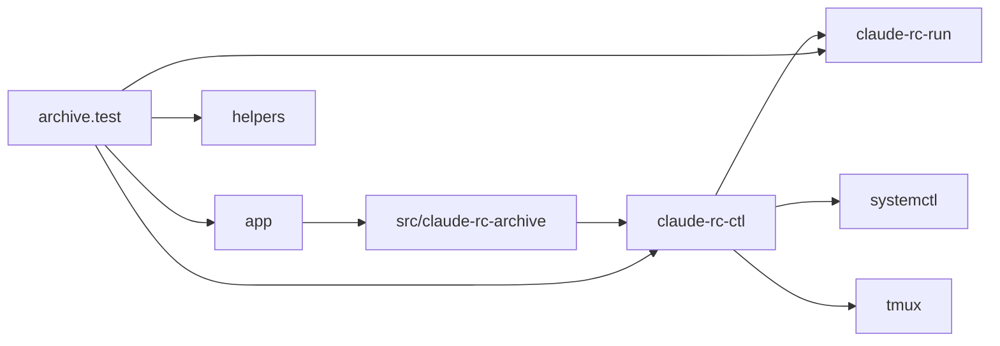
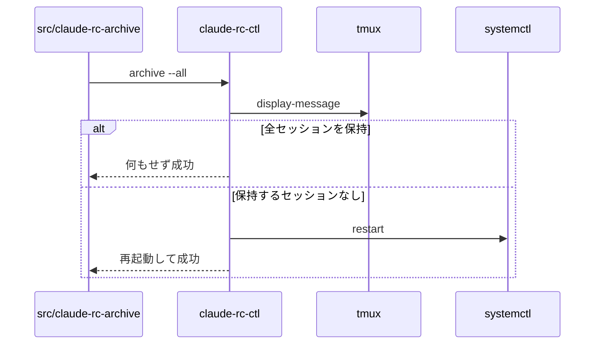

# claude-rc-archive 設計書

## 1. 構成

| パス                            | 責務                                                              |
| ------------------------------- | ----------------------------------------------------------------- |
| `src/claude-rc-ctl`             | archive サブコマンド。対象の選択、判定、サーバーの再起動を行う    |
| `src/claude-rc-run`             | セッションを事前に作らない指定で remote-control を起動する        |
| `src/claude-rc-archive.service` | 一括判定を1回実行する oneshot のユーザー単位ユニット              |
| `src/claude-rc-archive.timer`   | 一括判定を10分ごとに起動するタイマー                              |
| `installer/app.sh`              | 定期実行ユニットの配置・有効化・無効化・撤去と、旧ユニットの撤去  |
| `tests/helpers.mjs`             | tmux の display-message と systemctl の停止状態を返す擬似コマンド |
| `tests/archive.test.mjs`        | archive と定期実行ユニット、起動指定のテスト                      |

## 2. 関係図・ワークフロー

呼び出しと配置の依存方向を示す（テストを含む）。



一括判定の流れと、保持か再起動かの分岐を示す。



## 3. 設計項目

### D-1: アーカイブの仕組み (FR-1, FR-8)

remote-control は、停止シグナル（SIGTERM・SIGHUP）を受けると、配下の子セッションを止めたうえで、再開用の記録（ポインタ）がなければ、動作中のセッションをアーカイブして環境を登録解除する。ポインタは起動時にセッションを事前に作ったときだけ書かれ、あると再開用に保持されてアーカイブされない。そのため、起動ラッパーは事前作成を無効にして起動する。

```bash
exec claude remote-control \
  --no-create-session-in-dir \
  --spawn "${CLAUDE_RC_SPAWN:-same-dir}" \
  --permission-mode "${CLAUDE_RC_PERMISSION_MODE:-auto}" \
  --remote-control-session-name-prefix "$(hostname)-<name>"
```

サーバーの再起動は `systemctl --user restart claude-rc@<name>.service` とする。停止時に tmux のサーバーを閉じ、残ったプロセスへ systemd が SIGTERM を送り、既定の待ち時間内に終了を待つ。再起動後は新しい環境が登録され、セッションは利用者がアプリから作る。

### D-2: 判定 (FR-1, FR-2, FR-3, FR-4, FR-7)

```
claude-rc-ctl archive [--dry-run] <name>
  need_name <name>                              # 未登録は「未登録です」で終了コード1
  idle = ${CLAUDE_RC_ARCHIVE_MINUTES:-10080}      # 整数以外はエラー、0 なら何もせず成功
  systemctl --user is-active が active でない → 何もせず成功
  server = tmux -L claude-rc-<name> display-message -p -t <name> '#{pane_pid}'
  python3 で次を判定する
```

```python
sessions = server の直接の子プロセス              # 0件なら何もしない
for pid in sessions:
    last = transcript の更新時刻（なければプロセスの起動時刻）
    keep = 経過 < idle 分 | pid と子孫のいずれかが状態 R | リマインダーあり
if all(not keep):  dry なら表示のみ、そうでなければ systemctl --user restart
```

transcript は `${CLAUDE_CONFIG_DIR:-~/.claude}/projects/<cwd の英数字以外を - に置換した名前>/` にある。子の引数に `--session-id` か `--resume` の ID があればそのファイル、なければディレクトリ内で最も新しいファイルの更新時刻を使う。ファイルがなければ起動時刻だけで判定する。

リマインダーは、子の作業ディレクトリにある `.claude/scheduled_tasks.json` の `tasks` 配列が1件以上あることとする。セッションを開いている間だけ有効なリマインダーはファイルに残らないため検出できない。

出力は `[name] アーカイブ: セッション=<id または -> アイドル=<分>分` を対象ごとに出した後、`[name] 再起動` とする。保持するときは `[name] 保持: 理由=<アイドル不足|実行中|リマインダー>` とし、確認のみのときは先頭を「対象」に替える。

### D-3: 一括判定 (FR-5, NFR-1)

```
claude-rc-ctl archive [--dry-run] --all
  for 登録情報 in ~/.config/claude-rc/*.env
      archive_one <name>          # 失敗してもほかのインスタンスを続ける
  1件でも失敗したら終了コード1
```

インスタンス1件あたりの外部コマンドは systemctl・tmux・python3 の各1回（再起動時は systemctl をもう1回）に抑え、10件で5秒以内に収める。

### D-4: 定期実行 (FR-6)

```ini
# claude-rc-archive.service
[Service]
Type=oneshot
ExecStart=%h/.local/bin/claude-rc-ctl archive --all

# claude-rc-archive.timer
[Timer]
OnBootSec=10min
OnUnitActiveSec=10min
[Install]
WantedBy=timers.target
```

| 操作       | 処理                                                                                              |
| ---------- | ------------------------------------------------------------------------------------------------- |
| 導入・更新 | 旧名のタイマーを無効化して旧ユニットを削除し、2つのユニットをコピー、daemon-reload 後に有効化する |
| 削除       | `systemctl --user disable --now claude-rc-archive.timer` の後に2つのユニットを削除する            |
| パージ     | timers.target.wants 内のタイマーのリンクを削除する                                                |

## 4. エラー処理

| 事象                             | 処理                                                          |
| -------------------------------- | ------------------------------------------------------------- |
| 未登録の名前                     | 「未登録です」を標準エラーへ出し、終了コード1                 |
| 閾値が整数でない                 | 理由を標準エラーへ出し、そのインスタンスを飛ばして終了コード1 |
| サーバーのプロセスを特定できない | 警告を標準エラーへ出し、そのインスタンスを飛ばして成功        |
| リマインダーの定義が読めない     | 保持側に倒し、再起動しない                                    |
| 引数が不正                       | 使い方を出して終了コード1                                     |
