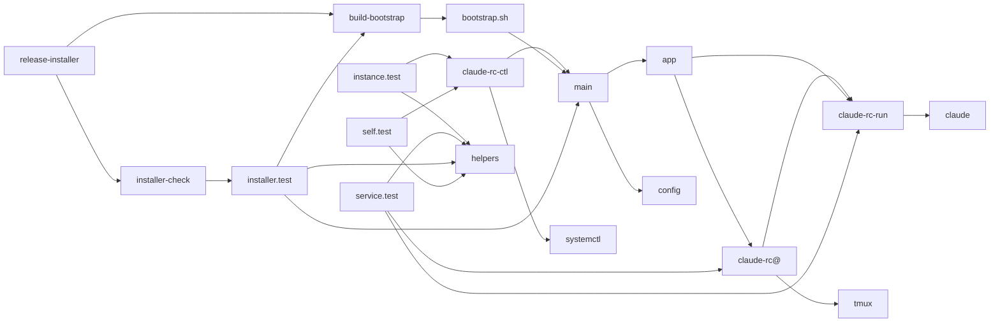
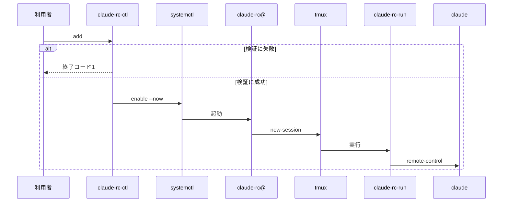
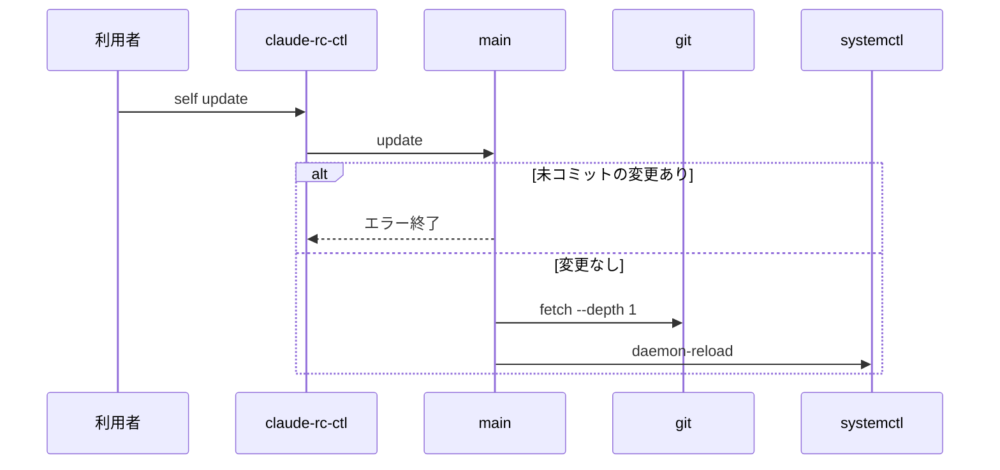

# claude-rc-ctl 設計書

## 1. 構成

| パス                                      | 責務                                                                                   |
| ----------------------------------------- | -------------------------------------------------------------------------------------- |
| `src/claude-rc-ctl`                       | インスタンス管理コマンド。self サブコマンドで installer/main.sh に委譲                 |
| `src/claude-rc-run`                       | tmux 内で remote-control を起動する起動ラッパー                                        |
| `src/claude-rc@.service`                  | インスタンスごとに展開されるユーザー単位の systemd テンプレートユニット                |
| `installer/bootstrap.sh.tmpl`             | 頒布するインストーラのひな形。ソース取得と本体への委譲だけを行う                       |
| `installer/build-bootstrap.sh`            | ひな形へ参照（完全名）・COMMIT・REPO_URL を埋め込んでインストーラを生成する            |
| `installer/main.sh`                       | 導入・更新・削除・状態表示の本体（共通部分。編集しない）                               |
| `installer/app.sh`                        | 導入物の配置と撤去（app_install・app_uninstall・app_purge）。宣言は同じ場所の app.conf |
| `installer/config.schema`                 | インストーラの設定キー宣言（宣言は0件）                                                |
| `.github/workflows/release-installer.yml` | 検査とインストーラの生成・頒布を行う CI。ブランチはアーティファクト、タグは Release    |
| `.github/workflows/installer-check.yml`   | 頒布の前に通す検査（シェル・テスト・spec-lint）                                        |
| `tests/helpers.mjs`                       | テスト用の擬似コマンド（systemctl・tmux・journalctl・claude・sudo）と実行補助          |
| `tests/instance.test.mjs`                 | インスタンス管理コマンドのテスト                                                       |
| `tests/service.test.mjs`                  | 起動ラッパーとユニットのテスト                                                         |
| `tests/installer.test.mjs`                | インストーラのテスト                                                                   |
| `tests/self.test.mjs`                     | self サブコマンドのテスト                                                              |

## 2. 関係図・ワークフロー

呼び出しと生成の依存方向を示す（テストと CI を含む）。



インスタンスの登録から常駐の開始まで、検証に失敗した場合の分岐を示す。



self 更新の流れと、取得先に未コミットの変更がある場合の分岐を示す。



## 3. 設計項目

### D-1: 配置先 (FR-9, NFR-3)

すべての導入物をユーザーのホーム配下に置き、管理者権限を使わない。コマンドとラッパーは取得先のファイルへのシンボリックリンクとし、更新は取得先の入れ替えだけで反映する。サービス定義だけはコピーして配置する。

| 種別                   | パス                                                       | 削除時の扱い                |
| ---------------------- | ---------------------------------------------------------- | --------------------------- |
| 取得先（git）          | `$CLAUDE_RC_CTL_DIR`、既定 `~/.local/share/claude-rc-ctl`  | 削除                        |
| コマンド               | `~/.local/bin/claude-rc-ctl`（取得先へのリンク）           | 削除                        |
| 起動ラッパー           | `~/.local/bin/claude-rc-run`（取得先へのリンク）           | 削除                        |
| サービス定義           | `~/.config/systemd/user/claude-rc@.service`                | 削除                        |
| 判定サービス・タイマー | `~/.config/systemd/user/claude-rc-archive.{service,timer}` | 削除                        |
| インスタンス登録情報   | `~/.config/claude-rc/<名前>.env`                           | パージ時だけ削除            |
| インストーラ設定       | `~/.config/claude-rc-ctl/claude-rc-ctl.env`                | パージ時だけ削除（権限600） |
| 導入メタ情報           | `~/.local/state/claude-rc-ctl-installer/state`             | パージ時だけ削除            |

### D-2: 登録と解除 (FR-1, FR-2, FR-7, FR-8)

```bash
# add [--spawn <same-dir|worktree>] <dir> [name]
dir=$(realpath "$1"); name=${2:-$(basename "$dir")}
[ -d "$dir" ]                          || fail "ディレクトリがありません"
[[ $name =~ ^[A-Za-z0-9_.-]+$ ]]       || fail "name は英数字と _ . - のみ"
[ ! -f "$CONF_DIR/$name.env" ]         || fail "既に登録済みです"
[ -z "$spawn" ] || [[ $spawn =~ ^(same-dir|worktree)$ ]] || fail "起動方式が不正です"
[ "$spawn" != worktree ] || git -C "$dir" rev-parse --git-dir || warn "git リポジトリではありません"
printf 'CLAUDE_RC_DIR=%q\n' "$dir" > "$CONF_DIR/$name.env"
[ -z "$spawn" ] || printf 'CLAUDE_RC_SPAWN=%q\n' "$spawn" >> "$CONF_DIR/$name.env"
systemctl --user daemon-reload
systemctl --user enable --now "claude-rc@$name.service"
is_trusted "$dir"                      || warn "未信頼です"

# remove <name>
systemctl --user disable --now "claude-rc@$name.service" || true
rm -f "$CONF_DIR/$name.env"
```

`--spawn` は位置引数の前に置き、指定がなければ登録情報へ `CLAUDE_RC_SPAWN` を書かず、起動ラッパーの既定値（same-dir）に任せる。

信頼判定は `~/.claude.json` の `projects.<dir>.hasTrustDialogAccepted` が真であるかどうかで行い、読めない場合は未信頼として扱う。検証の失敗は登録情報を作る前に終了コード1で終える。

### D-3: 一覧・操作・接続・ログ (FR-3, FR-4, FR-5, NFR-2)

| コマンド                           | 実行内容                                                                                  |
| ---------------------------------- | ----------------------------------------------------------------------------------------- |
| `list`                             | 登録情報ごとに `systemctl --user is-active` を1回呼び、3列で表示                          |
| `start\|stop\|restart\|status <n>` | `systemctl --user <cmd> claude-rc@<n>.service`                                            |
| `attach <n>`                       | `exec tmux -L claude-rc-<n> attach -t <n>`                                                |
| `logs <n>`                         | `tmux -L claude-rc-<n> capture-pane -p -t <n>` の後に `journalctl --user -u <unit> -n 30` |

未登録の名前を指定した操作は、登録情報の存在確認で失敗させ、サービスへは何も渡さない。一覧は登録情報の読み込みと状態取得だけで構成し、インスタンス1件あたりの外部コマンド呼び出しを1回に抑えて3秒以内に収める。

### D-4: 常駐起動 (FR-6, NFR-1)

```ini
[Service]
Type=forking
ExecStart=/usr/bin/tmux -L claude-rc-%i new-session -d -s %i %h/.local/bin/claude-rc-run %i
ExecStop=/usr/bin/tmux -L claude-rc-%i kill-server
Restart=always
RestartSec=10
```

```bash
# claude-rc-run <name>
. ~/.config/claude-rc/<name>.env                # CLAUDE_RC_DIR / CLAUDE_RC_SPAWN / CLAUDE_RC_PERMISSION_MODE / CLAUDE_RC_EFFORT
. "$NVM_DIR/nvm.sh"                             # claude を PATH に通す
cd "$CLAUDE_RC_DIR"
effort="${CLAUDE_RC_EFFORT:-medium}"
case "$effort" in low|medium|high|xhigh|max) ;; *) echo "不正な effort: $effort" >&2; sleep 30; exit 1 ;; esac
export CLAUDE_CODE_EFFORT_LEVEL="$effort"       # remote-control が起こす各セッションへ継承される
exec claude remote-control \
  --no-create-session-in-dir \
  --spawn "${CLAUDE_RC_SPAWN:-same-dir}" \
  --permission-mode "${CLAUDE_RC_PERMISSION_MODE:-auto}" \
  --remote-control-session-name-prefix "$(hostname)-<name>"
```

effort は claude の環境変数で渡す。remote-control には effort を指定するオプションがないためである。環境変数は子セッションへ継承され、アプリが子セッションへ渡す effort の指定や利用者の設定より優先されるので、実際の effort は登録情報の値になる。アプリのセッション画面の effort 表示は、アプリ側の既定値のまま変わらないことがある。不正な値は画面にメッセージを残して30秒待ち、claude を起動せず終了コード1で終える。

tmux は pty を提供するために使う。ユニットの更新は daemon-reload 後の次回起動から反映し、稼働中のサービスは自動では再起動しない。

### D-5: インストーラ (FR-9, NFR-3)

```
install.sh install [--ref <名前>] [--set KEY=VALUE ...]
  id -u が 0            → エラー終了（変更なし）
  git がない            → エラー終了
  update・uninstall     → 導入済みの claude-rc-ctl self <サブコマンド> へ委譲する
  取得先を git init/fetch --depth 1 <COMMIT> → checkout --detach → HEAD 一致を確認
  exec sh installer/main.sh install --ref <完全名> --commit C --repo-url U [...]
  --ref を指定したときは、埋め込みの参照とコミットを渡さず、本体が名前を解決して取得し直す

main.sh install（冪等）
  設定検証 → 設定ファイル生成（権限600）→ app_install → 導入メタ情報の書き込み → bin の claude-rc-ctl の存在確認
  app_install: tmux・python3・systemctl の存在確認と systemctl --user の疎通確認
               → bin へリンク作成（ln -sf）→ ユニットをコピー → daemon-reload
               → nvm・linger の警告
  app_install が失敗したときは、導入メタ情報を書き込まない（設定ファイルは残る）
  bin が PATH にないときは警告する
```

インストーラの生成は `sh installer/build-bootstrap.sh <参照の完全名> <COMMIT> <REPO_URL>` とする。参照の完全名は `refs/heads/` か `refs/tags/` で始まり、残りは英数字と `._/-` のみ、COMMIT は小文字16進40桁、REPO_URL は https または file で始まる値だけを受け付ける。

CI はブランチの push でアーティファクト `installer-<ブランチ名>` だけを作り、`v` で始まるタグの push で Release を作って `install.sh` と `install.sh.sha256` を添付する。ブランチ用のタグや Pre-release は作らない。ブランチの導入と切り替えは、Release の `install.sh` を実行してから `--ref` で行う。

### D-6: self 更新・切り替え・状態表示 (FR-10, FR-12)

```
claude-rc-ctl self <update|uninstall|status|refs> [...]
  → exec sh <ctl の実体の親>/../installer/main.sh <サブコマンド> [...]

main.sh update [--ref <名前>]（--commit なし）
  REPO_URL と、--ref がなければ導入中の参照を導入メタ情報から読む
  取得先に未コミットの変更がある → エラー終了
  resolve_ref → git fetch --depth 1 origin <完全名> → checkout --detach FETCH_HEAD
  exec sh main.sh update --ref <完全名> --commit <新コミット> --repo-url U   # 新しい版の main.sh で再適用
```

```
resolve_ref <名前>        # git ls-remote <REPO_URL> で解決する
  refs/heads/ か refs/tags/ で始まる → そのまま使う
  ブランチだけに存在      → refs/heads/<名前>
  タグだけに存在          → refs/tags/<名前>
  両方に存在              → エラー終了（完全名での指定を促す）
  どちらにも存在しない    → エラー終了（変更なし）
```

```
main.sh status 出力
  導入先: <DIR> / 参照: <名前>（branch|tag）/ コミット / 取得元 / 更新日時 / 設定: <設定ファイル>
main.sh refs 出力
  取得元のブランチ名とタグ名を、種別つきで1行ずつ表示する
```

導入メタ情報の参照は完全名で保存し、更新は常にその完全名を取得し直すので、ブランチは最新へ追従し、タグは指す先のコミットに留まる。コマンドの実体はシンボリックリンクの解決先とし、取得先がなければ導入を促すエラーで終える。インストーラの update は取得先の導入済みコマンドへ委ね、埋め込みコミットへ巻き戻さない。

### D-7: self 削除 (FR-11)

```
main.sh uninstall [--purge]
  app_uninstall: 登録情報ごとに systemctl --user stop → ユニット・bin のリンクを削除 → daemon-reload
  --purge のとき:
    app_purge: default.target.wants 内の claude-rc@*.service を削除 → daemon-reload
    ~/.config/claude-rc-ctl ~/.config/claude-rc ~/.local/state/claude-rc-ctl-installer を削除
  取得先の削除前に「.git が存在する」「$HOME や / などの危険なパスでない」ことを確認
  取得先を削除
```

パージなしの削除では、登録情報を残すので、再導入後に各インスタンスを `start` で再開できる。

## 4. エラー処理

| 事象                                         | 処理                                                  |
| -------------------------------------------- | ----------------------------------------------------- |
| 未登録の名前の操作                           | 「未登録です」を標準エラーへ出し、終了コード1         |
| 登録検証の失敗（名前・場所・重複・起動方式） | 理由を標準エラーへ出し、登録情報を作らず終了コード1   |
| 管理者での導入                               | 「一般ユーザーで実行してください」を出して終了コード1 |
| tmux・python3・systemctl・git の欠落         | 不足コマンド名を出して終了コード1                     |
| 起動時の effort が許可値以外                 | 理由を標準エラーへ出して30秒待ち、終了コード1         |
| 取得したコミットが埋め込み値と不一致         | エラー終了し、導入物を配置しない                      |
| 指定した名前が取得元にない・曖昧             | 理由を出して終了コード1。導入先と導入情報は変えない   |
| 取得先に未コミットの変更がある               | 更新を中止して終了コード1                             |
| 取得先が危険なパスまたは git 管理外          | 削除を中止して終了コード1                             |
