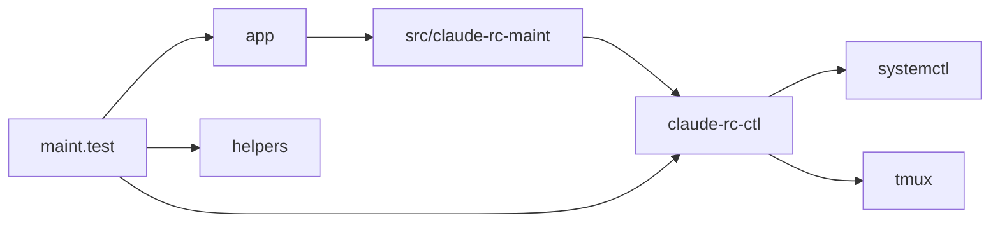
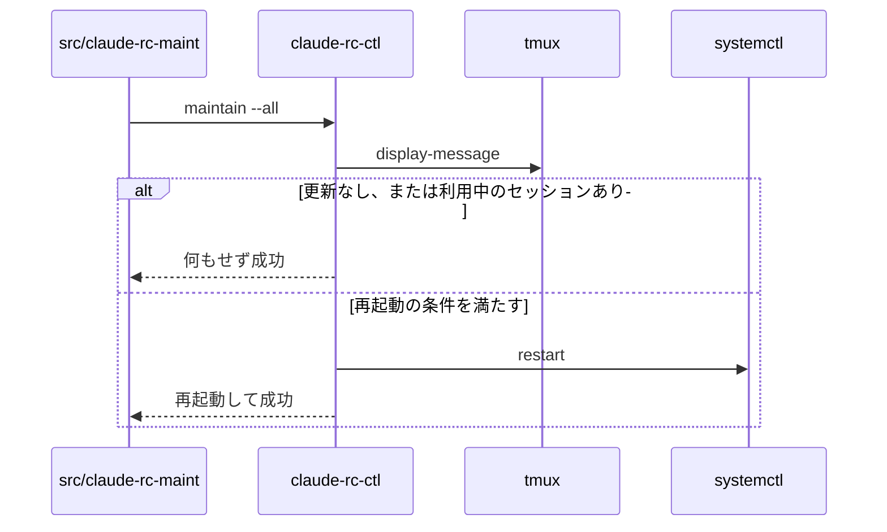

# claude-rc-maint 設計書

## 1. 構成

| パス                          | 責務                                                                                                  |
| ----------------------------- | ----------------------------------------------------------------------------------------------------- |
| `src/claude-rc-ctl`           | maintain サブコマンド。対象の選択、本体の更新と実行ファイルの消失の判定、再起動、版の削除、警告を行う |
| `src/claude-rc-maint.service` | 一括判定を1回実行する oneshot のユーザー単位ユニット                                                  |
| `src/claude-rc-maint.timer`   | 一括判定を10分ごとに起動するタイマー                                                                  |
| `installer/app.sh`            | 定期実行ユニットの配置・有効化・無効化・撤去と、旧名のユニットの撤去                                  |
| `tests/helpers.mjs`           | tmux の display-message・capture-pane と systemctl の停止状態を返す擬似コマンド                       |
| `tests/maint.test.mjs`        | maintain と定期実行ユニットのテスト                                                                   |

## 2. 関係図・ワークフロー

呼び出しと配置の依存方向を示す（テストを含む）。



一括判定の流れと、見送りか再起動かの分岐を示す。



## 3. 設計項目

### D-1: 判定と再起動 (FR-1, FR-2, FR-7)

```
claude-rc-ctl maintain [--dry-run] <name>
  need_name <name>                              # 未登録は「未登録です」で終了コード1
  systemctl --user is-active が active でない → 何もせず成功
  server = tmux -L claude-rc-<name> display-message -p -t <name> '#{pane_pid}'
  起動失敗・認証失敗の警告を行い、python3 で次を判定する
```

```python
stale, missing = 本体の更新、固定した実行ファイルの消失     # どちらも偽なら何もせず終了（プロセスを調べない）
sessions = server の直接の子プロセス
for pid in sessions:
    pid と子孫のいずれかが状態 R → 保持(実行中)
    missing                      → 実行ファイル消失
    リマインダーあり             → 保持(リマインダー)
    それ以外                     → 本体更新
保持がない（セッションなしを含む） → missing なら終了コード 12、そうでなければ 11（再起動）
保持がある → 見送りの警告を出して終了コード 0（次回の定期実行で再判定する）
```

各セッションは `[name] セッション=<子の --session-id の値、なければ -> 判定=<判定>` と表示する。リマインダーは、子とサーバーの作業ディレクトリにある `.claude/scheduled_tasks.json` の `tasks` 配列が1件以上あることとし、読めない定義は保持側に倒す。リマインダーを持つセッションは、再起動後にメッセージを受けるまで起動されず、時刻が来ても実行されないため見送る。

再起動は `systemctl --user restart claude-rc@<name>.service` とする。停止時の remote-control は環境を保持し、再起動後のサーバーが同じ環境を再利用するため、セッションは再接続される。

| 終了コード | 表示（確認のみのとき）                                                                                             |
| ---------- | ------------------------------------------------------------------------------------------------------------------ |
| 11         | `[name] 本体更新: サーバーを再起動する`（`[name] 対象: claude 本体が更新されたためサーバーを再起動する`）          |
| 12         | `[name] 実行ファイル消失: サーバーを再起動する`（`[name] 対象: 実行ファイルが削除されたためサーバーを再起動する`） |

### D-2: 一括判定 (FR-5, NFR-1)

```
claude-rc-ctl maintain [--dry-run] --all
  for 登録情報 in ~/.config/claude-rc/*.env
      maintain_one <name>         # 失敗してもほかのインスタンスを続ける
  cleanup_versions                # 版の削除
  1件でも失敗したら終了コード1
```

インスタンス1件あたりの外部コマンドは systemctl と python3 の各1回、tmux の2回（プロセスの特定と画面出力の取得）、認証失敗の検出の python3 1回を基本とし、再起動時は systemctl をもう1回呼ぶ。10件で5秒以内に収める。

### D-3: 定期実行 (FR-6)

```ini
# claude-rc-maint.service
[Service]
Type=oneshot
ExecStart=%h/.local/bin/claude-rc-ctl maintain --all

# claude-rc-maint.timer
[Timer]
OnBootSec=10min
OnUnitActiveSec=10min
[Install]
WantedBy=timers.target
```

| 操作       | 処理                                                                                                                                 |
| ---------- | ------------------------------------------------------------------------------------------------------------------------------------ |
| 導入・更新 | 旧名（claude-rc-reap・claude-rc-archive）のタイマーを無効化してユニットを削除し、2つのユニットをコピー、daemon-reload 後に有効化する |
| 削除       | `systemctl --user disable --now claude-rc-maint.timer` の後に2つのユニットを削除する                                                 |
| パージ     | timers.target.wants 内のタイマーのリンクを削除する                                                                                   |

### D-4: 本体の更新の検出 (FR-1)

サーバーは、起動ラッパーが版ごとに固定した実行ファイル（`versions/<版>/…`）で動き、自分の実行ファイルのパスから子セッションを起動する。claude 本体が更新されても動作は変わらないが、新しい版へ切り替えるために再起動する。固定した版の `source` に記録した元の場所（`command -v claude` の結果）を開き直し、サーバーの `/proc/<pid>/exe` と同じファイルでなければ更新されたと判定する。

```python
exe = readlink(/proc/<server>/exe)              # 読めなければ更新されていないものとして扱う
pinned = exe が versions/ の中
if pinned:  stale = source を開けて、inode も（大きさ・更新時刻）も一致しない   # 開けなければ判定しない（更新の途中）
else:       stale = exe が " (deleted)" で終わる       # 版を固定する前のサーバー
```

同じファイルとは、inode が一致するか、大きさと更新時刻が一致することとする（複製がハードリンクでない場合）。再起動は配下のセッションを失わないため、猶予時間は設けず、実行中の子プロセスかリマインダーを持つセッションがなくなった最初の判定で再起動する。

### D-5: 固定した実行ファイルの消失 (FR-3)

固定した実行ファイルが削除されると（利用者による削除）、サーバーは動き続けるが、新しいセッションを起動できず、アプリにはオンラインと表示されたままになる。待っても回復しないため、リマインダーの有無によらず再起動する。実行中のセッションだけは作業を失わないよう保持する。

```python
missing = readlink(/proc/<server>/exe) が versions/ の中で、" (deleted)" で終わる
missing のとき:
    警告「サーバーの実行ファイルが削除されている。新しいセッションを起動できない」を出す
    for pid in sessions:  実行中 → 保持(実行中)、それ以外 → 実行ファイル消失
```

| 出力                     | 内容                                                      |
| ------------------------ | --------------------------------------------------------- |
| 実行中のセッションがある | `[name] 警告: 実行中のセッションがあるため再起動を見送る` |

### D-6: 使われなくなった版の削除 (FR-4)

本体が更新されるたびに、固定した版の複製が残る（元が入れ替わると、ハードリンクの複製は旧版の内容を保ち、容量を使う）。一括判定の最後に、どのプロセスも使っていない版を削除する。起動ラッパーは起動のたびに版のディレクトリの更新時刻を新しくするので、作られたばかりの版（起動の途中）は消さない。

```python
root = ~/.local/share/claude-rc/versions
used = { /proc/*/exe のリンク先（" (deleted)" を除く）が root/<版>/ で始まるときの <版> }   # 読めないプロセスは飛ばす
for d in root の直下:
    d が used にある、または更新時刻が10分以内 → 残す
    確認のみ → 「[版] 対象: 使われていない版 <d> を削除する」を表示する
    それ以外 → 削除し「[版] 削除: <d>」を表示する（.tmp- で始まる起動途中の残骸も同じ条件で消す）
```

一括判定（`--all`）のときだけ行い、名前を指定した判定では行わない。置き場所がなければ何もしない。

### D-7: セッションの起動失敗の警告 (FR-8)

サーバーが子セッションを起動するときに実行ファイルがないと、起動に失敗し、サーバーの画面に次の行が出る。このセッションはアプリ上で応答しないまま残る。実行ファイルが戻ったあとにメッセージを送り直すと、サーバーが同じセッションを起動し直して応答するため、サーバーは再起動せず警告だけを行う。

```
[08:26:18] Session failed: spawn error: ENOENT: no such file or directory, posix_spawn '<実行ファイル>' <セッションID>
```

```
report_failures <name> <server の pid>          # プロセスの特定の直後に行う
  lines = tmux -L claude-rc-<name> capture-pane -p -J -S - -t <name> のうち
          '^\[HH:MM:SS\] Session failed:' に一致する行   # 履歴全体、折り返しは連結
  seen  = ~/.local/state/claude-rc/<name>.failed の「pid 件数」（pid が違えば 0）
  件数 > seen:  警告と対処を標準エラーへ出す
  件数 != seen: 「pid 件数」を書き込む（確認のみのときは書かない）
```

警告は `[name] 警告: セッションの起動に失敗した記録が <増えた件数> 件ある（最新: <行>）` と `[name] 対処: 応答しないセッションにはメッセージを送り直す。繰り返すときは claude-rc-ctl restart <name> を実行する` の2行とする。定期実行ではジャーナルに残る。記録のファイルは、登録解除でそのインスタンスの分を、パージでディレクトリごと削除する。

### D-8: 認証失敗で止まったセッションの警告 (FR-8)

通信の一時的な遮断（Cloudflare の `403 Attention Required`）でも、claude は「認証失敗」として扱い、セッションの記録の最後に次の応答（API エラー扱い）を残して止まる。資格情報は有効なことが多く、メッセージを送り直せば続けられるため、サーバーは再起動せず警告だけを行う。

```
{"type":"assistant","isApiErrorMessage":true,"message":{"content":[{"type":"text","text":"Failed to authenticate. API Error: 403 ..."}]}, ...}
```

```
report_auth_failures <name> <server の pid>     # report_failures の直後に行う
  対象  = ${CLAUDE_CONFIG_DIR:-~/.claude}/projects/ のうち、CLAUDE_RC_DIR の実パスの記号を - にした名前（worktree は配下の名前の前方一致）の
          直下の *.jsonl で、更新時刻がサーバーの起動時刻以降のもの
  失敗  = 対象の最後の記録が isApiErrorMessage の assistant で、本文が 'Failed to authenticate' で始まるもの
  seen  = ~/.local/state/claude-rc/<name>.authfail の記録の uuid の一覧
  失敗のうち seen にないものがあれば、警告と対処を標準エラーへ出す
  現在の失敗の uuid の一覧を書き込む（確認のみのときは書かない。回復したセッションの分は消える）
```

警告は `[name] 警告: 認証に失敗して止まったセッションの記録が <件数> 件ある（最新: <起動時刻> <セッションID> <本文>）` と `[name] 対処: 通信の一時的な遮断でも起きる。そのセッションにメッセージを送り直す。繰り返すときは claude auth status で資格情報を確認する` の2行とする。

## 4. エラー処理

| 事象                             | 処理                                                   |
| -------------------------------- | ------------------------------------------------------ |
| 未登録の名前                     | 「未登録です」を標準エラーへ出し、終了コード1          |
| 実行ファイルのリンクを読めない   | 本体は更新されていないものとして扱う                   |
| サーバーのプロセスを特定できない | 警告を標準エラーへ出し、そのインスタンスを飛ばして成功 |
| リマインダーの定義が読めない     | 保持側に倒し、再起動しない                             |
| 画面出力を取得できない           | 起動失敗の記録はないものとして扱う                     |
| セッションの記録を読めない       | 認証失敗の記録はないものとして扱う                     |
| 版の複製を削除できない           | 警告を標準エラーへ出し、ほかの版の処理を続ける         |
| 廃止した設定が登録情報にある     | 読まずに無視する                                       |
| 引数が不正                       | 使い方を出して終了コード1                              |
